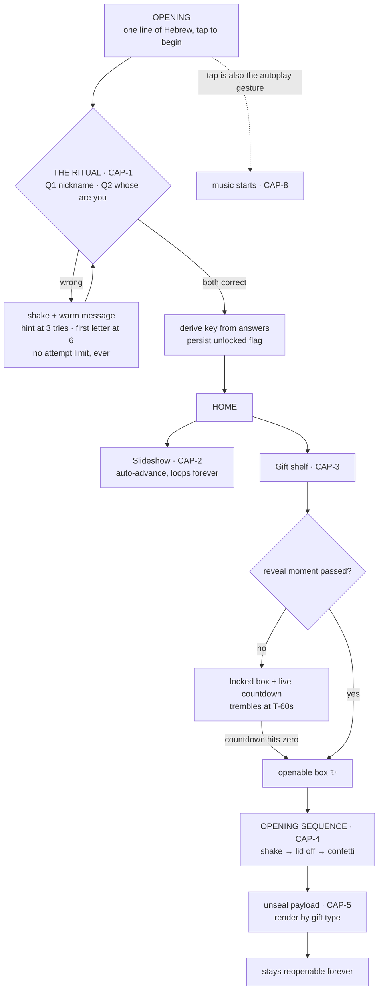
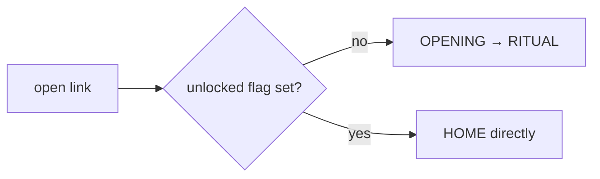
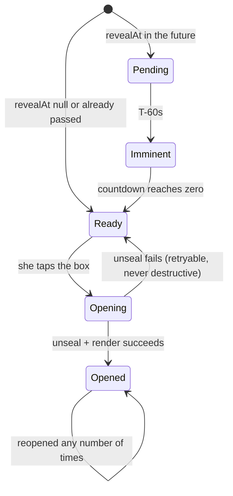
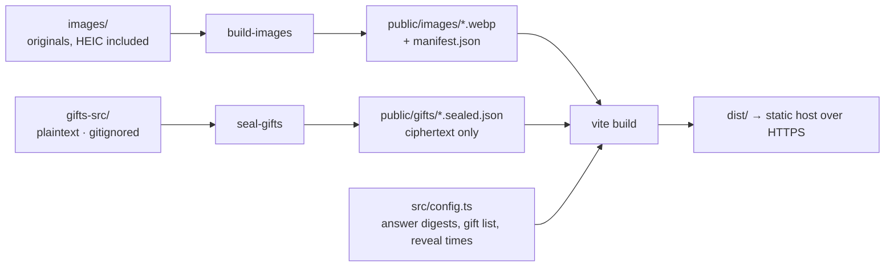

# Flow Diagrams

Companion to `SPEC.md`. Holds all diagrams; the kernel carries prose only.

## Screen flow (CAP-1 → CAP-4)

## Returning visit

`localStorage` holds the unlocked flag, so the ritual is a first-visit event. The derived key is **not** persisted — it is re-derived from the stored answer digests' preimages only during a live unlock, so a returning visitor skips the gate but a fresh unseal still requires the session that answered.

## Gift state machine (CAP-3, CAP-4)

`Pending → Ready` must be driven by the corrected clock (see `stack.md § Clock`), not by `Date.now()` alone.

## Build pipeline

